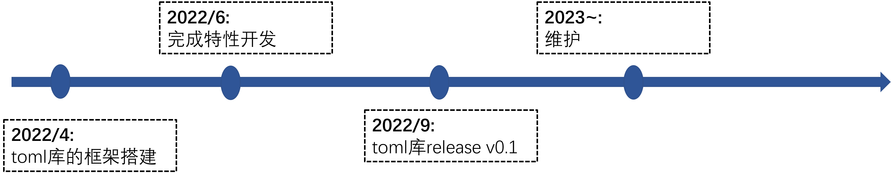
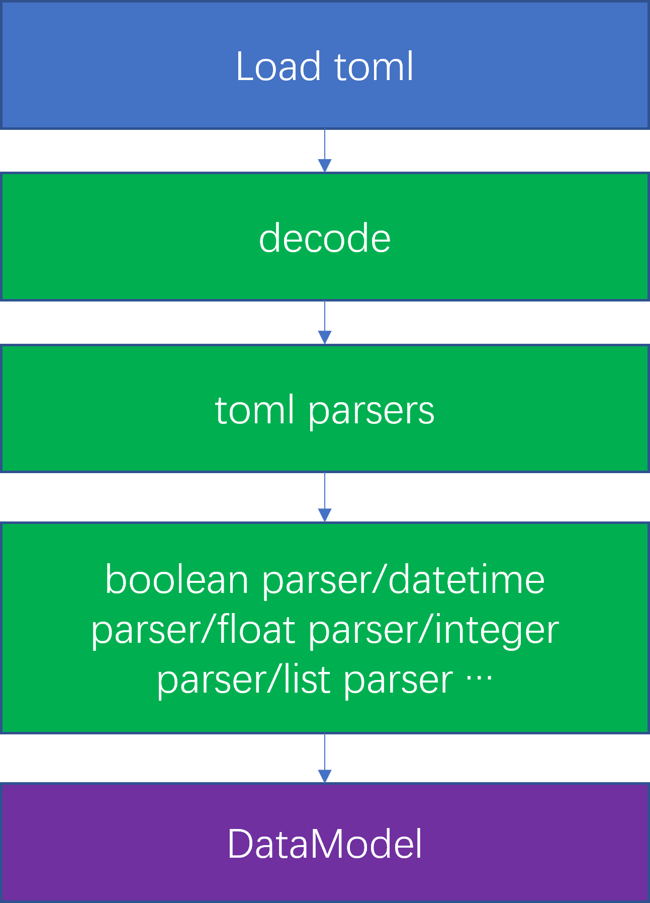

<div align="center">
<h1>TOML4CJ</h1>
</div>

<p align="center">


</p>

##  简介

TOML4CJ 旨在成为一个语义明显且易于阅读的最小化配置文件格式。TOML4CJ 被设计成可以无歧义地映射为哈希表。TOML4CJ 应该能很容易地被解析成各种语言中的数据结构。
参考toml语法规约地址: https://toml.io/cn/

该项目是仓颉语言实现 TOML4CJ v1.0.0 的语言库。参考地址：https://github.com/uiri/toml

### 特性

- 🚀 语义明显**易于阅读**
- 🚀 能**无歧义**地映射为哈希表
- 💪 **易于解析**成各种语言中的数据结构
- 🛠️ 具备实用的原生类型
- 🌍 受到广泛支持

### 路线

<p align="center">

</p>

##     架构

### 架构图：

<p align="center">

</p>

- 通过 load 入口载入 toml 文件

- 区分语法使用不同 parser 进行解析

- 最后生成 DataModel 方便仓颉读取

### 源码目录：

```shell
.
├── README.md
├── doc
│   ├── assets
│   ├── cjcov
│   ├── design.md
│   └── feature_api.md
├── res
│   ├── example.toml
│   └── multiline_string.toml
├── src
│   ├── decoder.cj
│   ├── exception.cj
│   ├── POJO.cj
│   ├── symbols.cj
│   └── toml_tz.cj
└── test
    ├── HLT
    ├── LLT
    └── UT
```

- `doc` 是库的设计文档、提案、库的使用文档、LLT 覆盖率
- `src` 是库源码目录
- `test` 是测试用例所在目录，包括 HLT 用例、LLT 用例和 UT 用例

### 接口说明

目前只实现对整数、浮点数、字符串、布尔类型字面量的解码。详情见[API](./doc/feature_api.md)

#### class Decoder

```
// 初始化 Decoder
public init()
public init(payload: String)

// 解码 toml 文件， pn 为文件路径
public func load(pn: String)

// 实现解码功能
public func decode()
```

##  使用说明

### 编译

```shell
git clone https://gitee.com/HW-PLLab/toml4cj.git
git clone https://gitee.com/HW-PLLab/testJekins.git
cd toml4cj

cp -r ../testJekins/src/ci_test .;
python3 ci_test/main.py build   ---> 编译
python3 ci_test/main.py test;   ---> 执行 test/LLT 用例
```

test/LLT 用例书写参考：https://gitee.com/HW-PLLab/cangjie-library-pages/wikis 的门禁测试脚本使用方式

## 功能示例

```toml4cj
key = "value"
bare_key = "value"
bare-key = "value"
1234 = "value"
```

```shell
from toml4cj import decoders.*

main() {
    let decoder: Decoder = Decoder()
    decoder.load("integer002.toml")
    let a = decoder.decode()
    println(a)
}
```

运行结果如下:

```shell
{"key":"value","bare_key":"value","bare-key":"value","1234":"value"}
```

### TOML4CJ 提供读取 toml 文件数据的功能示例
  用例执行需要 toml 文件

```toml4cj
from toml4cj import decoders.*
from std import os.posix.*
main () {
    var path2: String = "${getcwd()}/test.properties"
    let decoder: Decoder = Decoder()
    try {
        decoder.load(path2)
    } catch (e: IllegalArgumentException) {
        if (e.toString() == "IllegalArgumentException: The format of the file is not supported.") {
            return 0
        }
        return 1
    }
    let a = decoder.decode()
    println(a)
    return 1
}

```

运行结果如下:

```shell
return 1
```

### TOML4CJ 提供解析 toml 文件数据的功能示例  
（备注：  参考toml语法规约地址: [https://toml.io/cn/](https://gitee.com/link?target=https%3A%2F%2Ftoml.io%2Fcn%2F) ）
 用例执行需要toml文件

```toml4cj
from toml4cj import decoders.*
from std import os.posix.*
let a = ##"{"int1":"+99","int2":"42","int3":"0","int4":"-17"}"##
let b = ##"{"int5":"1_000","int6":"5_349_221","int7":"53_49_221","int8":"1_2_3_4_5"}"##
main() {
    var path2: String = getcwd()
    let decoder: Decoder = Decoder()
    decoder.load("${path2}/integer001.toml")
    var json = decoder.decode()
    if (json.toString() != a) {
        return 1
    }
    decoder.load("${path2}/integer002.toml")
    json = decoder.decode()
    if (json.toString() != b) {
        return 2
    }
    return 0
}
```

运行结果如下:

```shell
{"key":"value","bare_key":"value","bare-key":"value","1234":"value"}
```

##  参与贡献

欢迎给我们提交PR，欢迎给我们提交Issue，欢迎参与任何形式的贡献。