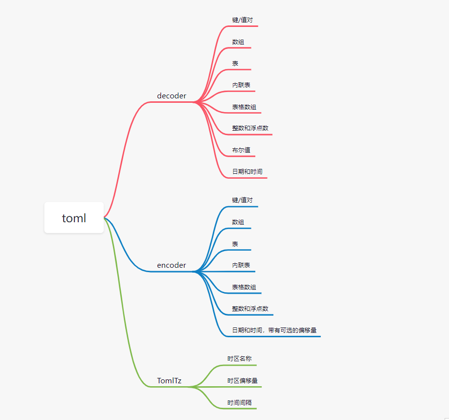

### 三方库设计说明

#### 1 需求场景分析

TOML 是一种由于明显的语义而易于阅读的最小配置文件格式。它明确映射到哈希表。TOML 应该易于解析为各种语言的数据结构。
TOML 与用于应用程序配置和数据序列化的其他文件格式共享特征，例如 YAML 和 JSON。TOML 和 JSON 都很简单，并且使用无处不在的数据类型，使它们易于编码或用机器解析。TOML 和 YAML 都强调人类可读性功能，例如使给定行的目的更容易理解的注释。TOML 在组合这些方面有所不同，允许注释（与 JSON 不同）但保持简单性（与 YAML 不同）。

因为 TOML 明确地打算作为一种配置文件格式，所以解析它很容易，但它不打算用于序列化任意数据结构。TOML 在文件的顶层总是有一个哈希表，它可以很容易地将数据嵌套在它的键中，但它不允许顶层数组或浮点数，因此它不能直接序列化一些数据。也没有标准来识别 TOML 文件的开始或结束，这会使通过流发送文件变得复杂。这些细节必须在应用层协商。

INI 文件经常与 TOML 进行比较，因为它们在语法上的相似性和用作配置文件。然而，INI 没有标准化的格式，它们不能优雅地处理超过一或两层的嵌套。

进一步阅读：

TOML 规范: https://toml.io/en/

YAML 规范：https://yaml.org/spec/1.2/spec.html

JSON 规范：https://tools.ietf.org/html/rfc8259

#### 2 三方库对外提供的特性

（1） 用于实现 toml 文件的解码和编码

（2） 简洁且归一化的接口

（3） 支持裸键

（4） 支持 整数/ 浮点数/ 字符串(多行字符串不支持)/ 布尔类型的字面量.

（5） 不支持 引号键和分隔符键(父键丢失)

（6） 不支持 [table] 表

（7） 不支持进制转换

（8） 不支持value为多行字符串

（9） 不支持array数组表

#### 3 License分析

MIT License

|  Permissions   | Limitations  |
|  ----  | ----  |
| Commercial use | Liability |
| Modification  | Warranty |
| Distribution  |   |
| Private use   |   |

#### 4 依赖分析

```
标准库 
from std import io.*
from std import collection.*
from std import regex.*
from std import unicode.*
from std import convert.*
from std import time.*
from encoding import json.*
from serialization import serialization.*

```

#### 5 特性设计文档

仓颉TOML实现是基于String和文件FIle实现对TOML配置的解析. 通过使用String的切割/索引/转换/拆分等函数功能实现toml文件解析成json格式. 

##### 5.1 接口设计

💡 decoder toml文件解码器

| 成员函数 | 入参 | 返回值 | 作用描述 |
| --- | --- |  --- | --- |
| init | / | Decoder | 创建toml解码器对象 |
| load | string | Unit | 用于加载toml文件路径字符串 |
| load | File | Unit | 用于加载toml文件File对象 |
| decode | / | JsonObject | 解码并生成JsonObject |

💡 TomlTz toml 解码器和编码器 时间格式生成工具类. 

| 成员函数 | 入参 | 返回值 | 作用描述 |
| --- | --- | --- | ---  |
| init | String | TomlTz | 创建TomlTz对象 |
| tzname | / | String | 返回时区和偏移量的字符串 |
| utcOffset | / | Duration | 返回UTC时区+偏移量的时间间隔 |
| dst | / | Duration | 返回时间间隔 |
| location | / | Location | 返回时区和偏移量的时区信息 |

###### 5.2 展示示例
integer002.toml文件
```toml4cj
key = "value"
bare_key = "value"
bare-key = "value"
1234 = "value"
```
```cangjie
from toml4cj import decoders.*

main() {
    let decoder: Decoder = Decoder()
    decoder.load("integer002.toml")
    let a = decoder.decode()
    println(a)
}
```

```cangjie
{"key":"value","bare_key":"value","bare-key":"value","1234":"value"}
```


#### 🚀 6 架构图



